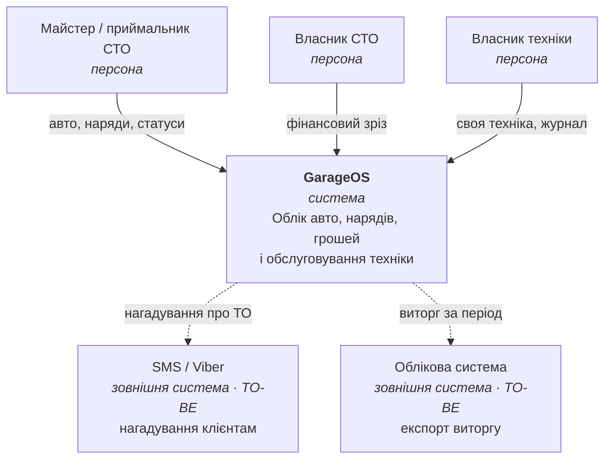

# 00 · Огляд і системний контекст

## Що таке GarageOS

GarageOS — застосунок для обліку обслуговування техніки, що працює у **двох
режимах** із спільним ядром даних:

- **Сервісний режим** (`src/app/(service)/`) — інструмент СТО: дошка робіт,
  картотека авто клієнтів, гроші та борги, нагадування про ТО.
- **Особистий режим** (`src/app/personal/`) — особистий гараж: власна техніка
  (авто, мото, будь-яка обслуговувана машина) з журналом обслуговування.

Спільне між режимами — та сама ідея: **техніка, її пробіг, історія робіт і
те, що треба зробити далі.** Різниця — чия це техніка і чи є за неї рахунок.

## Межі системи

**Усередині (зафіксовано в контракті):**
- картотека авто клієнтів: номер, власник, телефон, пробіг, статус, борг;
- замовлення-наряди: опис скарги, перелік робіт і деталей, оплата, дні очікування;
- дошка робіт — активні авто, згруповані за статусом;
- фінансовий зріз за період: виторг, частка робіт і деталей, кількість візитів,
  список боржників;
- нагадування про наступне обслуговування з позначкою простроченості;
- особистий гараж: одиниці техніки з журналом записів (олива, гальма, шини, фільтри).

**Поза межами (свідомо):**
- бухгалтерія та податкова звітність;
- розрахунок зарплат механіків;
- торгівля запчастинами / каталоги постачальників;
- телематика та OBD-діагностика в реальному часі;
- планування змін і завантаження постів за розкладом (нині статуси, не календар).

## Актори

| Актор | Режим | Головні сценарії |
|-------|-------|------------------|
| **Майстер / приймальник СТО** | сервісний | завести авто з нарядом, вести дошку робіт, закрити борг |
| **Власник СТО** | сервісний | фінансовий зріз за тиждень/місяць/рік, боржники |
| **Власник техніки** | особистий | своя техніка, журнал обслуговування, що наступне |

Поточний контракт **не містить автентифікації й ролей** — режим обирається в
застосунку, не правами. Це свідома межа прототипу, див.
[05-cross-cutting.md](05-cross-cutting.md#автентифікація-та-доступ).

## Контекстна діаграма

Пунктир — заплановані інтеграції; у контракті їх ще немає.

## Ключові сценарії

1. **Завести авто.** `POST /cars` з `CreateCarInput`. Якщо `createOrder: true`,
   одночасно створюється наряд зі скаргою (`complaint`) і авто стає `in_work`;
   інакше — `ready`. Номер нормалізується у верхній регістр, телефон — до
   останніх 10 цифр.
2. **Дошка робіт.** `useWorkBoard` склеює `GET /cars` і `GET /orders` на клієнті
   та групує авто за `CarStatus`, підтягуючи скаргу й `daysWaiting` з відкритого
   наряду. Окремого серверного ендпойнта немає — **свідомо**, див.
   [04-api-surface.md](04-api-surface.md#композиція-на-клієнті).
3. **Картка авто.** `GET /cars/{id}` повертає авто, усі його наряди та
   `sameOwnerCount` — скільки ще авто на тому ж телефоні.
4. **Гроші.** `GET /finance?period=week|month|year` — агрегат за період плюс
   боржники, відсортовані за спаданням боргу, і сумарний борг.
5. **Нагадування.** `GET /reminders` — плоский read-model: нагадування вже
   склеєне з даними авто (номер, власник, телефон) і позначкою `overdue`.
6. **Особистий гараж.** `GET /my-vehicles`, `GET /my-vehicles/{id}` — техніка з
   вкладеним журналом `LogEntry[]`.

## Якісні атрибути

| Атрибут | Цільове значення | Чому саме так |
|---------|------------------|---------------|
| Масштаб | одне СТО, сотні авто, десятки активних нарядів | інструмент майстра, не мережі |
| Відгук | p95 < 300 ms на читання | нині мок має 180–520 ms штучної латентності як орієнтир |
| Клієнт | мобільний (iOS/Android) + web через `react-native-web` | майстер працює з телефона в цеху |
| Стійкість до збоїв | кожен екран має стани `pending` / `error` / `retry` | `src/components/ui/query-state.tsx` |
| Мова | інтерфейс і помилки — українські | первинний користувач — українське СТО |
| Гроші | UAH, цілі гривні | у контракті `number`, без копійок і валюти |

→ Далі: [01 · Контейнери](01-containers.md)
