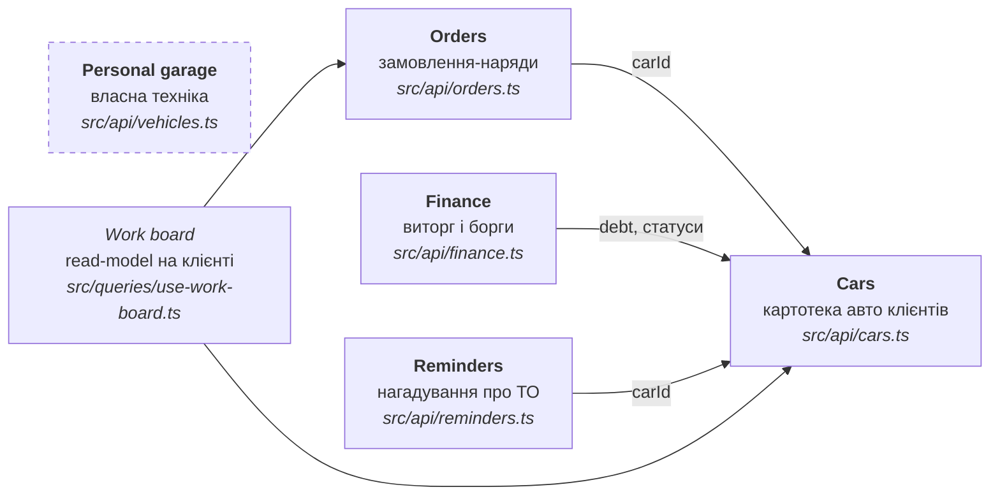

# 02 · Домени

Домени виведені з модулів `GarageOSMobile/src/api/` — саме вони нині визначають
межі. Бекенд має повторити цей поділ, щоб шов транспорту лишився тонким.



## Карта доменів

| Домен | Відповідальність | Сутності | Залежить від | Ендпойнти |
|-------|------------------|----------|--------------|-----------|
| **Cars** | авто клієнта як довготривала картка: власник, контакт, пробіг, статус, борг | `Car`, `CreateCarInput`, `CarDetail` | — | `GET /cars`, `GET /cars/{id}`, `POST /cars` |
| **Orders** | конкретний візит: скарга, роботи, деталі, оплата | `Order`, `OrderWork`, `OrderPart`, `OrderDetail` | Cars (`carId`) | `GET /orders`, `GET /orders/{id}` |
| **Finance** | агрегат за період + хто винен гроші | `FinanceStats`, `FinancePeriod`, `FinanceOverview` | Cars (`debt`) | `GET /finance?period=` |
| **Reminders** | що і коли треба обслужити, чи прострочено | `ReminderItem` | Cars | `GET /reminders` |
| **Personal garage** | своя техніка та журнал обслуговування | `MyVehicle`, `LogEntry`, `LogEntryKind` | — (ізольований) | `GET /my-vehicles`, `GET /my-vehicles/{id}` |

## Зв'язки та правила

**Cars — ядро.** Три з п'яти доменів посилаються на авто. `Car.status` типу
`CarStatus` (`in_work` / `waiting_part` / `ready` / `has_debt`) — це стан, який
читає дошка робіт, а `Car.debt` — те, з чого Finance збирає боржників.

**Orders дублює статус.** `Order.status` має той самий тип `CarStatus`, що й
`Car.status`. У моку вони виставляються узгоджено, але **інваріант ніде не
забезпечений**. Це перше, що бекенд мусить вирішити: хто власник статусу —
авто чи наряд. Див. [03-data-model.md](03-data-model.md#відкриті-питання-моделі).

**Personal garage ізольований.** `MyVehicle` не має `carId` і не перетинається
з картотекою СТО: інша сутність, інший режим, свій журнал. Об'єднувати їх не
треба — у них різні власники даних.

**Work board — не домен.** Це read-model, зібраний на клієнті з `Cars` і
`Orders`. Серверного ендпойнта для нього немає свідомо
([04-api-surface.md](04-api-surface.md#композиція-на-клієнті)).

## Проєкція на структуру `GarageOSWeb` (TO-BE)

```
GarageOS.Api/
  Features/
    Cars/        CarsController, CarDto, CarDetailDto, CreateCarRequest
    Orders/      OrdersController, OrderDto, OrderDetailDto
    Finance/     FinanceController, FinanceOverviewDto
    Reminders/   RemindersController, ReminderItemDto
    Vehicles/    VehiclesController, MyVehicleDto, LogEntryDto
  Domain/        сутності та правила статусів
  Infrastructure/ персистентність (ADR-0004)
```

Поділ за фічами, а не за типами (`Controllers/`, `Services/`, `Models/`) —
щоб зміна одного домену лишалася в одній папці й збігалася з межею модуля на
клієнті. Див. [ADR-0003](adr/0003-monorepo-layout.md).

→ Далі: [03 · Модель даних](03-data-model.md)
