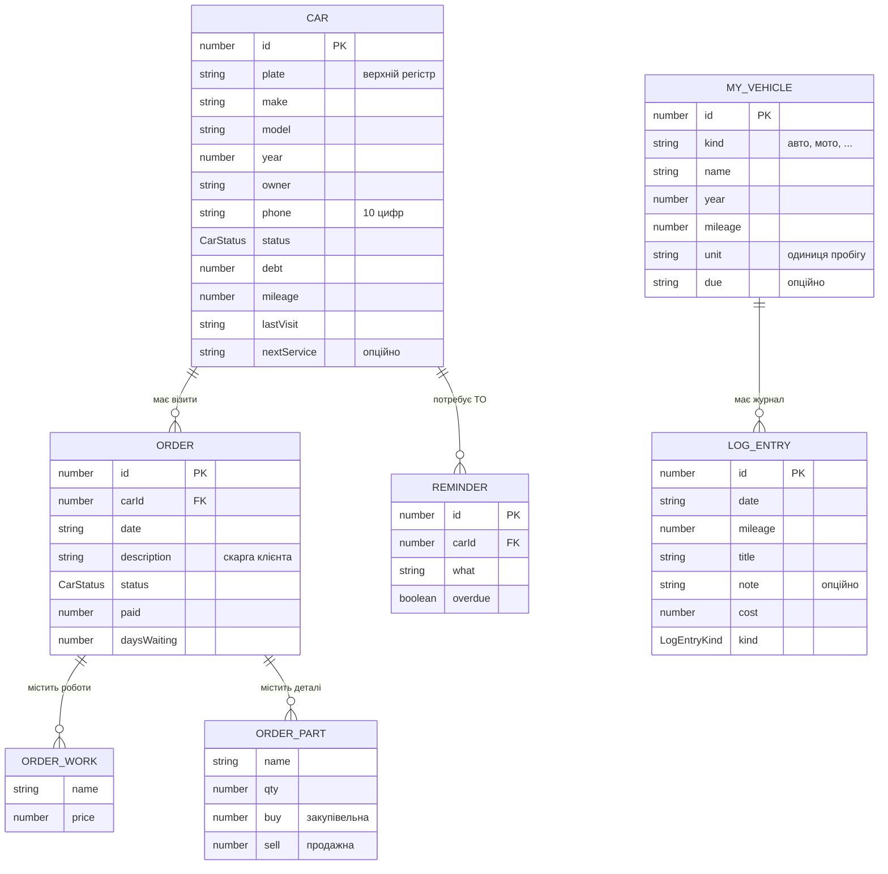

# 03 · Модель даних

Усе на цій сторінці дослівно відповідає `GarageOSMobile/src/types/domain.ts`.
Якщо щось розійшлося — помилка в атласі, не в коді.

## ER-схема

`ORDER_WORK` і `ORDER_PART` — **вкладені масиви в наряді**, не окремі таблиці:
в контракті це `works: OrderWork[]` і `parts: OrderPart[]` без власних `id`.
Для бекенда це означає вибір: або лишити їх як JSON-колонку, або нормалізувати
й додати `id` — тоді зміниться контракт клієнта.

## Перелічення

| Тип | Значення | Де використовується |
|-----|----------|---------------------|
| `CarStatus` | `in_work`, `waiting_part`, `ready`, `has_debt` | `Car.status`, `Order.status`, групування дошки робіт |
| `FinancePeriod` | `week`, `month`, `year` | параметр `GET /finance` і ключ кешу |
| `LogEntryKind` | `oil`, `brakes`, `tires`, `filter`, `other` | `LogEntry.kind` (іконка в журналі) |

## Read-моделі

Це не сутності, а форми відповідей — бекенд мусить віддавати саме їх:

| Модель | Поля | Джерело |
|--------|------|---------|
| `CarDetail` | `car`, `orders: Order[]`, `sameOwnerCount: number` | `src/api/cars.ts` |
| `OrderDetail` | `order`, `car` | `src/api/orders.ts` |
| `FinanceOverview` | `stats: FinanceStats`, `debtors: Car[]`, `totalDebt: number` | `src/api/finance.ts` |
| `ReminderItem` | `id`, `carId`, `plate`, `owner`, `phone`, `what`, `overdue` | `src/api/reminders.ts` |
| `FinanceStats` | `earned`, `works`, `parts`, `visits` | `domain.ts` |
| `WorkBoardRow` | `car`, `description?`, `daysWaiting` | `src/queries/use-work-board.ts` (лише клієнт) |

`sameOwnerCount` — кількість **інших** авто з тим самим `phone`.
`debtors` — авто з `debt > 0`, відсортовані за спаданням боргу.
`totalDebt` — сума їхніх боргів.

## Інваріанти, які нині тримає тільки мок

Бекенд мусить забезпечити їх явно:

1. **Нормалізація при створенні.** `plate` — `trim().toUpperCase()`;
   `phone` — тільки цифри, останні 10; `make`, `model`, `owner` — `trim()`.
2. **Дефолти.** `year` → поточний рік, `mileage` → `0`, `debt` → `0`,
   `description` → `'Без опису'`, якщо скарга порожня.
3. **Статус при створенні.** `createOrder: true` → `in_work`, інакше `ready`.
4. **Новий наряд разом з авто.** `createOrder: true` створює наряд з
   `works: []`, `parts: []`, `paid: 0`, `daysWaiting: 0` і скаргою з `complaint`.
5. **Наряд не існує без авто.** `GET /orders/{id}` повертає 404 і тоді, коли
   наряд є, а його авто немає.
6. **Відповідь — копія.** Клієнт отримує дані, які не ділить із жодним іншим
   запитом (на моку це глибока копія; у HTTP це виконується саме собою).

## Відкриті питання моделі

- **Хто власник статусу?** `CarStatus` живе і в `Car`, і в `Order`. Варіанти:
  статус наряду первинний і авто його відображає; або `Car.status` — похідне
  поле, що рахується з відкритих нарядів і боргу. Нині не вирішено.
- **Чи може авто мати кілька відкритих нарядів?** `useWorkBoard` бере
  `orders.data?.find((row) => row.carId === car.id)` — **перший знайдений**,
  тобто код неявно припускає один відкритий наряд. Моделі це ніде не закріплює.
- **Дати як рядки.** `date`, `lastVisit`, `nextService`, `due` — `string`
  у людському форматі (`src/lib/format.ts`, `todayLabel()`), не ISO. Бекенду
  потрібне або ISO + форматування на клієнті (зміна контракту), або віддавати
  готові мітки (зберігає контракт, ускладнює сортування).
- **Гроші як `number`.** Без копійок і валюти. Для фінансових сум на сервері
  природніше `decimal`; на межі API це все одно число.
- **Немає `id` у `OrderWork` / `OrderPart`.** Рядок роботи не можна адресувати,
  тобто редагування окремого рядка неможливе без зміни контракту.

→ Далі: [04 · Поверхня API](04-api-surface.md)
