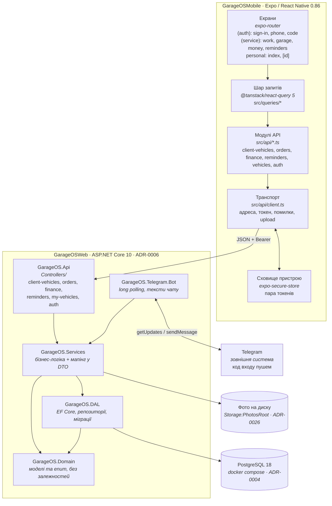

# 01 · Контейнери

## Runtime



## Опис контейнерів

| Контейнер | Технологія | Відповідальність | Стан |
|-----------|-----------|------------------|------|
| **mobile** | Expo SDK 57, RN 0.86, React 19.2, TypeScript 6, expo-router | Весь UI, навігація, кеш і стани запитів, композиція read-моделей | працює проти справжнього API по HTTP |
| **api** | .NET 10, ASP.NET Core, EF Core 10, OpenAPI | Реалізація контракту `src/api/*`, персистентність, доступ | 36 ендпойнтів контракту + 5 входу, `[Authorize]` на всіх контролерах; валідації вхідних даних немає (`TO-BE`) |
| **bot** | `Telegram.Bot`, long polling у `TelegramBotHostedService` | Транспорт Telegram: розбір апдейтів, тексти чату, надсилання кодів | працює; у продакшні — вебхук із `X-Telegram-Bot-Api-Secret-Token` (`TO-BE`) |
| **db** | PostgreSQL 18 (контейнер) | Збереження авто, нарядів, нагадувань, журналів, акаунтів і кодів входу | 12 таблиць, 11 міграцій (`payments` прибрано, [ADR-0016](adr/0016-order-line-payment.md)) |
| **фото** | тека на диску, `Storage:PhotosRoot` | Файли знімків машин і нарядів; у базі лише `photo_id` | працює; у продакшні — змонтований том ([ADR-0026](adr/0026-vehicle-photo-storage.md)) |

## Ключова архітектурна точка: шов транспорту

`src/api/*.ts` — це **єдиний шов між клієнтом і сервером**. Кожна функція там
уже оголошує свій ендпойнт рядком:

```ts
export function getClientVehicles(): Promise<ClientVehicle[]> {
  return request('GET /client-vehicles');
}
```

`request(endpoint, body?)` і `upload(endpoint, file)` з `src/api/client.ts` —
єдина реалізація цього шва. Вони тримають усе, чого не мусять знати екрани:

- **адресу** — `EXPO_PUBLIC_API_URL`, інакше хост із адреси Metro плюс порт
  `5101` ([ADR-0008](adr/0008-mobile-http-transport.md));
- **токен** — `Authorization: Bearer` на кожному запиті, а для захищених
  картинок — `authorizedSource()`, бо `expo-image` ходить по URL сам;
- **помилки** — `ProblemDetails` сервера перекладається в `ApiError`
  (`detail` → `message`, `instance` → `endpoint`, `status` → `status`);
- **тихий refresh** — один повтор на `401`, крім `/auth/*`
  ([ADR-0028](adr/0028-session-lasts-a-working-day.md));
- **multipart** — `Content-Type` лишається на `fetch`, частина складається з
  `File` з `expo-file-system` ([ADR-0026](adr/0026-vehicle-photo-storage.md)).

Мок-транспорту (`src/api/mock/`) більше немає: він був саме тим, що заміняється
без переписування екранів, і своє відпрацював. Умова, яку шов накладає на
`GarageOSWeb`, лишилася: **відповіді мусять точно збігатися за формою** з
`domain.ts`, включно зі склеєними read-моделями (`ClientVehicleDetail`,
`OrderDetail`, `FinanceOverview`, `ReminderItem`).

Див. [ADR-0002](adr/0002-client-contract-source-of-truth.md).

## Межі розгортання

- **mobile** — збірка Expo (EAS або локально), плюс web-таргет через
  `react-native-web`.
- **api** — контейнер Linux; `Dockerfile` уже є в `GarageOSWeb/GarageOS.Api/`,
  `DockerDefaultTargetOS=Linux` у csproj.
- Базова URL-адреса API береться з `EXPO_PUBLIC_API_URL`, а якщо її немає — з
  адреси Metro плюс порт `5101`. Тому телефон у тій самій Wi-Fi працює без
  налаштування, а release-білд обов'язково отримує змінну
  ([ADR-0008](adr/0008-mobile-http-transport.md)).
- **фото** — тека `Storage:PhotosRoot` мусить бути змонтованим томом поза
  текою публікації; інакше знімки зникнуть із наступним деплоєм, а дамп
  Postgres їх не містить ([ADR-0026](adr/0026-vehicle-photo-storage.md)).

→ Далі: [02 · Домени](02-domains.md)
