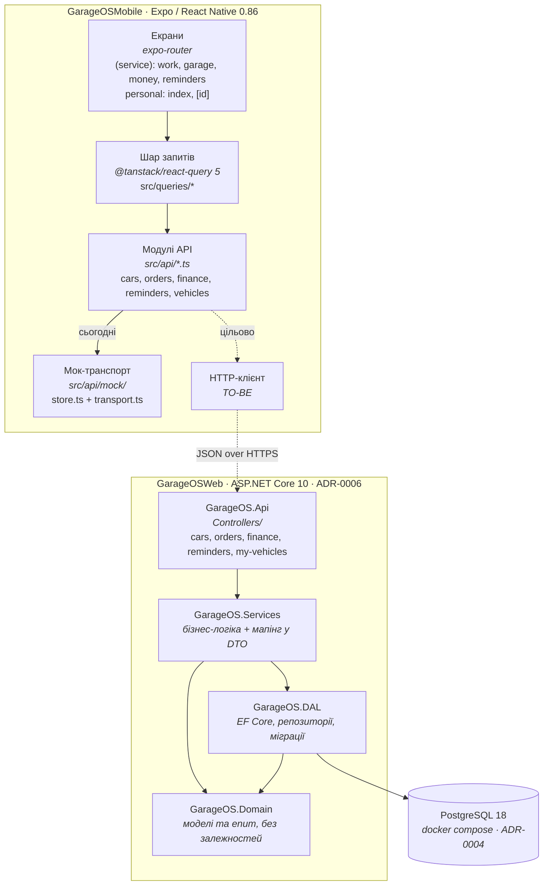

# 01 · Контейнери

## Поточний і цільовий runtime



## Опис контейнерів

| Контейнер | Технологія | Відповідальність | Стан |
|-----------|-----------|------------------|------|
| **mobile** | Expo SDK 57, RN 0.86, React 19.2, TypeScript 6, expo-router | Весь UI, навігація, кеш і стани запитів, композиція read-моделей | працює на моках |
| **api** | .NET 10, ASP.NET Core, EF Core 10, OpenAPI | Реалізація контракту `src/api/*`, валідація, персистентність | усі 9 ендпойнтів є, без авторизації й даних |
| **db** | PostgreSQL 18 (контейнер) | Збереження авто, нарядів, нагадувань, журналів | 11 таблиць, перша міграція |

## Ключова архітектурна точка: шов транспорту

`src/api/*.ts` — це **єдиний шов між клієнтом і сервером**. Кожна функція там
уже оголошує свій ендпойнт рядком:

```ts
export function getCars(): Promise<Car[]> {
  return request('GET /cars', () => store.cars);
}
```

`request(endpoint, resolve)` з `mock/transport.ts` імітує HTTP: додає 180–520 ms
латентності, вміє кидати `ApiError` зі статусом і — важливо — **повертає глибоку
копію** (`JSON.parse(JSON.stringify(...))`), щоб екрани не могли мутувати стор
за посиланням.

Перехід на реальний бекенд — це заміна реалізації `request`, а не переписування
екранів: `src/queries/*` і компоненти не знають, звідки дані. Умова, яку це
накладає на `GarageOSWeb`: **відповіді мусять точно збігатися за формою** з тим,
що сьогодні повертає мок, включно зі склеєними read-моделями
(`CarDetail`, `OrderDetail`, `FinanceOverview`, `ReminderItem`).

Див. [ADR-0002](adr/0002-client-contract-source-of-truth.md).

## Межі розгортання

- **mobile** — збірка Expo (EAS або локально), плюс web-таргет через
  `react-native-web`.
- **api** — контейнер Linux; `Dockerfile` уже є в `GarageOSWeb/GarageOS.Api/`,
  `DockerDefaultTargetOS=Linux` у csproj.
- Базова URL-адреса API на клієнті поки ніде не задана — з'явиться разом із
  HTTP-клієнтом (`expo-constants` уже в залежностях і підходить для цього).

→ Далі: [02 · Домени](02-domains.md)
