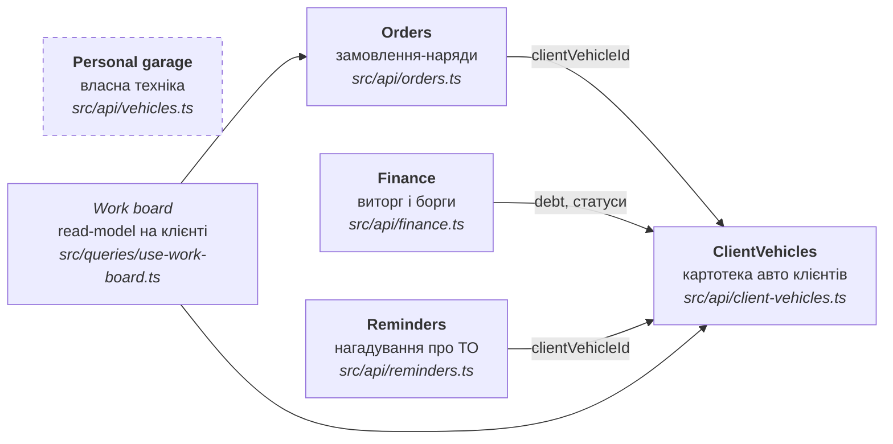

# 02 · Домени

Домени виведені з модулів `GarageOSMobile/src/api/` — саме вони нині визначають
межі. Бекенд має повторити цей поділ, щоб шов транспорту лишився тонким.



## Карта доменів

| Домен | Відповідальність | Сутності | Залежить від | Ендпойнти |
|-------|------------------|----------|--------------|-----------|
| **ClientVehicles** | авто клієнта як довготривала картка: власник, контакт, пробіг, статус, борг | `ClientVehicle`, `CreateClientVehicleInput`, `UpdateClientVehicleStatusInput`, `ClientVehicleDetail`, `PhotoSize` | — | `GET /client-vehicles`, `GET /client-vehicles/{id}`, `POST /client-vehicles`, `PUT /client-vehicles/{id}/status`, `POST /client-vehicles/{id}/pay`, три `/photo` |
| **Orders** | конкретний візит: скарга, роботи, деталі, оплата рядків | `Order`, `OrderWork`, `OrderPart`, `OrderPhoto`, `OrderWorkInput`, `OrderPartInput`, `PaymentStatus`, `OrderDetail`, `CreateOrderInput`, `UpdateOrderInput` | ClientVehicles (`clientVehicleId`) | `GET /orders`, `GET /orders/{id}`, `POST`/`PUT`/`DELETE` на `/orders` та на рядках `/works` і `/parts`, `POST /orders/{id}/pay`, три `/photos` |
| **Finance** | агрегат за період + хто винен гроші | `FinanceStats`, `FinancePeriod`, `FinanceOverview` | ClientVehicles (`debt`), Orders (рядки) | `GET /finance?period=` |
| **Reminders** | що і коли треба обслужити, чи прострочено | `ReminderItem` | ClientVehicles | `GET /reminders` |
| **Personal garage** | своя техніка та журнал обслуговування | `MyVehicle`, `CreateMyVehicleInput`, `UpdateMyVehicleInput`, `LogEntry`, `CreateLogEntryInput`, `UpdateLogEntryInput`, `LogEntryKind`, `MileageUnit` | — (ізольований) | одинадцять `/my-vehicles*`: читання, `POST`/`PUT`/`DELETE` техніки та записів журналу, три `/photo` |

## Зв'язки та правила

**ClientVehicles — ядро.** Три з п'яти доменів посилаються на авто.
`ClientVehicle.status` типу `ClientVehicleStatus` (`in_work` /
`waiting_part` / `ready` / `has_debt`) — це стан, який читає дошка робіт, а
`ClientVehicle.debt` — те, з чого Finance збирає боржників.

**Статус тепер в одному місці.** Доти той самий `CarStatus` стояв і в авто, і в
наряді, а інваріант не забезпечувало ніщо. Питання «хто власник статусу»
закрите на користь авто: наряд статусу не має
([ADR-0017](adr/0017-order-without-own-status-and-date.md)).

**Оплата — властивість рядка наряду, не суми.** `OrderWork` і `OrderPart`
несуть `paymentStatus`; борг авто й виторг за період — похідні від рядків
([ADR-0016](adr/0016-order-line-payment.md)).

**Personal garage ізольований.** `MyVehicle` не має `clientVehicleId` і не перетинається
з картотекою СТО: інша сутність, інший режим, свій журнал. Об'єднувати їх не
треба — у них різні власники даних.

**Work board — не домен.** Це read-model, зібраний на клієнті з
`ClientVehicles` і `Orders`. Серверного ендпойнта для нього немає свідомо
([04-api-surface.md](04-api-surface.md#композиція-на-клієнті)).

## Проєкція на структуру `GarageOSWeb`

```
GarageOS.Domain/        Models/ (11 моделей) Enums/ (ClientVehicleStatus, MileageUnit,
                        PaymentStatus, LogEntryKind, FinancePeriod, PhotoSize)
GarageOS.DAL/           Entities/ Configurations/ Context/ Repositories/ Migrations/
GarageOS.Services/      ClientVehicleService, OrderService, FinanceService, ReminderService,
                        MyVehicleService, AuthService, TelegramSignInService
                        + Dtos/ Mapping/ Photos/ Security/ Exceptions/
GarageOS.Telegram.Bot/  транспорт Telegram: BotUpdateHandler, BotTexts, TelegramNotifier
GarageOS.Api/           Controllers/ (ClientVehicles, Orders, Finance, Reminders,
                        MyVehicles, Auth) Infrastructure/
```

Поділ за шарами, а не за фічами. Межа домену на сервері проходить не папкою, а
трійкою «сервіс + репозиторій + контролер» з однаковою назвою: домен
`ClientVehicles` — це `ClientVehicleService`, `ClientVehicleRepository` і
`ClientVehiclesController`. Див.
[ADR-0006](adr/0006-backend-layering.md), який скасував попередній намір різати
сервер за фічами.

**Work board** серверного відповідника не має й тут: його збирає клієнт.

→ Далі: [03 · Модель даних](03-data-model.md)
