# 03 · Модель даних

Усе на цій сторінці дослівно відповідає `GarageOSMobile/src/types/domain.ts`.
Якщо щось розійшлося — помилка в атласі, не в коді.

## ER-схема

```mermaid
erDiagram
    CLIENT_VEHICLE ||--o{ ORDER : "має візити"
    CLIENT_VEHICLE ||--o{ REMINDER : "потребує ТО"
    ORDER ||--o{ ORDER_WORK : "містить роботи"
    ORDER ||--o{ ORDER_PART : "містить деталі"
    ORDER ||--o{ ORDER_PHOTO : "має фото"
    MY_VEHICLE ||--o{ LOG_ENTRY : "має журнал"
    USER_PROFILE ||--o{ MY_VEHICLE : "володіє"

    CLIENT_VEHICLE {
        number id PK
        string plate "верхній регістр"
        string make
        string model
        number year "опційно"
        string owner
        string phone "10 цифр"
        ClientVehicleStatus status
        number debt "похідне, не колонка"
        number mileage "опційно"
        MileageUnit mileageUnit
        string lastVisit
        string nextService "опційно"
        string photoId "опційно, uuid"
    }

    ORDER {
        number id PK
        number clientVehicleId FK
        string date "з CreatedAt, окремої колонки немає"
        string description "скарга клієнта"
        number daysWaiting "похідне від CreatedAt"
    }

    ORDER_WORK {
        number id PK
        string description
        number price
        PaymentStatus paymentStatus
    }

    ORDER_PART {
        number id PK
        string description
        number buy "закупівельна"
        number sell "продажна, вона ж підсумок рядка"
        PaymentStatus paymentStatus
    }

    REMINDER {
        number id PK
        number clientVehicleId FK
        string what
        boolean overdue
    }

    MY_VEHICLE {
        number id PK
        string kind "авто, мото, ..."
        string name
        number year
        number mileage
        MileageUnit mileageUnit
        string photoId "опційно, uuid"
    }

    ORDER_PHOTO {
        number id PK
        number orderId FK
        string photoId "uuid, ім'я файла"
    }

    LOG_ENTRY {
        number id PK
        string date "з CreatedAt, окремої колонки немає"
        string note "що зроблено, єдиний опис"
        number cost
        LogEntryKind kind
        number mileage "опційно"
        MileageUnit mileageUnit
    }

    USER_PROFILE {
        number id PK
        string firstName
        string lastName "опційно, як у Telegram"
        string phone "10 цифр, засвідчений ботом"
    }
```

`CLIENT_VEHICLE` — це авто клієнта в картотеці СТО. Доти воно звалося `Car`, і
глосарій мусив щоразу пояснювати, що це **не** `MyVehicle`; назви тримають цю
межу самі ([ADR-0014](adr/0014-client-vehicle-rename.md)). Зовнішній ключ —
`clientVehicleId`, бо `vehicleId` уже означає `MyVehicle` у записі журналу.

`USER_PROFILE` з'явився разом зі входом ([ADR-0007](adr/0007-telegram-sign-in.md)).
Пошти й паролю в ньому немає як поняття: особу засвідчує бот Telegram, і
`phone` тут — засвідчений номер, а не контактне поле.

Ім'я лежить двома полями, бо двома полями його й віддає Telegram:
`firstName` завжди є, `lastName` опційне
([ADR-0010](adr/0010-user-name-split-no-photo.md)). Склеєного `name` немає
свідомо — хто показує повне ім'я, складає його сам, і ніхто не розбиває рядок
за пробілом. **Фото профілю не зберігається**: колонка `photoUrl` була й
ніколи не заповнювалась, тож її прибрано; аватарки будуються з ініціалів. Зв'язок із `MY_VEHICLE` більше не односторонній: `GET /my-vehicles`
залежить від суб'єкта, а `POST /my-vehicles` ставить `userId` із claim `sub`
([ADR-0019](adr/0019-create-my-vehicle.md)).

`Session` — **не сутність**, а конверт відповіді входу (токени, `expiresIn`,
`master`), тому його місце в [04-api-surface](04-api-surface.md#вхід), а не тут.
Серверна схема входу — таблиця `login_codes` і refresh-колонки в `users` — у
контракті клієнта не відображається взагалі: клієнт про неї не знає.

`ORDER_WORK` і `ORDER_PART` приїжджають **вкладеними масивами в наряді** —
`works: OrderWork[]` і `parts: OrderPart[]`, — але кожен рядок має власний `id`
і власний шлях: `/orders/{id}/works/{workId}`. Вибір, який тут колись стояв
(JSON-колонка чи нормалізація з `id`), вирішено на користь другого
([ADR-0024](adr/0024-order-lines-get-identity.md)): рядок правиться поодинці,
не переписуючи наряд.

**У рядка деталі немає кількості.** `sell` — підсумок рядка, не ціна за
одиницю: дві деталі — або два рядки, або один рядок на суму
([ADR-0016](adr/0016-order-line-payment.md)). Натомість у кожного рядка — своя
`paymentStatus`: оплата живе на рядках, а не сумою в наряді.

**У наряду немає власного статусу.** Статус має тільки авто
([ADR-0017](adr/0017-order-without-own-status-and-date.md)); `date` і
`daysWaiting` — похідні від `CreatedAt`, колонок під них немає.

**Фото наряду — окрема таблиця, бо їх багато.** `order_photos`: рядок на
знімок, каскад від `orders`, два id — цілий для контракту й `uuid` для імені
файла ([ADR-0027](adr/0027-order-photos.md)). Віддаються в `OrderDetail`, а не
полем `Order`, щоб не з'явився третій прапорець `include*`.

**Фото — це id, а не байти й не шлях.** `photo_id uuid null` у
`client_vehicles` **і** в `my_vehicles`; самі файли лежать на диску, у теці за
id тієї машини, і роздаються окремим ендпойнтом під токеном
([ADR-0026](adr/0026-vehicle-photo-storage.md)).
Розширення в базі немає, бо формат на диску один; шляху немає, бо шляхи в
таблиці гниють з першою ж реорганізацією тек. Відсутній `photoId` означає «фото
немає» — і це **єдині дані системи, яких немає в дампі Postgres**.

**Вкладена колекція може приїхати порожньою навмисно.** `log`, `works` і
`parts` віддаються лише на запит — `?includeLog=`, `?includeLines=`
([ADR-0018](adr/0018-include-flags-for-nested-collections.md)). Тому `log: []`
означає або «записів немає», або «не просили»: розрізняє це той, хто запитував,
а не той, хто читає відповідь.

## Перелічення

| Тип | Значення | Де використовується |
|-----|----------|---------------------|
| `ClientVehicleStatus` | `in_work`, `waiting_part`, `ready`, `has_debt` | `ClientVehicle.status`, групування дошки робіт |
| `MileageUnit` | `km`, `hours` | `ClientVehicle`, `MyVehicle`, `LogEntry` ([ADR-0015](adr/0015-mileage-unit.md)) |
| `PaymentStatus` | `unpaid`, `paid` | `OrderWork.paymentStatus`, `OrderPart.paymentStatus` |
| `FinancePeriod` | `week`, `month`, `year` | параметр `GET /finance` і ключ кешу |
| `PhotoSize` | `full`, `thumb` | параметр `size` у `GET /client-vehicles/{id}/photo/{photoId}` ([ADR-0026](adr/0026-vehicle-photo-storage.md)) |
| `LogEntryKind` | `oil`, `brakes`, `tires`, `filter`, `other` | `LogEntry.kind` (іконка в журналі) |

По дроту йде код, людині показується український підпис: статуси — через
`STATUS_META` у `src/theme/status.ts`, одиниці пробігу — через
`MILEAGE_UNIT_LABEL` у `src/lib/format.ts`. Українського тексту в базі немає.

## Що в доменній моделі редагується

Моделі в `GarageOS.Domain/Models/` ділять властивості на дві групи, і поділ
однаковий у всіх:

- **`init`** — тотожність і належність: `Id`, `CreatedAt`, та зовнішні ключі,
  що відповідають на питання «чия це річ» (`ClientVehicle.ClientId`,
  `MyVehicle.UserId`, `Order.ClientVehicleId`, `LogEntry.VehicleId`,
  `User.TelegramId`). Переносити авто іншому власнику чи техніку іншому
  акаунту — це **передача**, окрема операція зі своїми правилами, а не правка
  поля. Навігаційні властивості (`ClientVehicle.Client`,
  `Reminder.ClientVehicle`) теж `init`: їх складає мапер, а не прикладний код.
- **`set`** — усе, що майстер або власник справді міняє на екрані: статус,
  пробіг і його одиниця, дати, суми (`OrderWork.Price`,
  `OrderPart.Buy`/`Sell`, `LogEntry.Cost`), стан оплати рядка, описи й назви.
  Сюди ж `ClientVehicle.Plate` — перереєстрація та виправлення помилки
  виглядають для моделі однаково.

Борг у цьому поділі відсутній навмисно: `ClientVehicle` більше **не має** поля
`Debt` — воно похідне від нарядів ([ADR-0011](adr/0011-debt-derived-from-orders.md)).
`Order` так само не має ні `Paid`, ні `Status`, ні `DaysWaiting`.

Два місця, де поділ не очевидний:

| Властивість | Чому `set` |
|-------------|------------|
| `Client.UserId` | Зв'язок із акаунтом виникає **після** картки: майстер заводить клієнта задовго до того, як той уперше увійде. |
| `User.Phone` | «Іншого шляху в це поле немає, крім `request_contact`» — це про **походження** значення, не про незмінність: людина з новим номером перепідтверджує його. |

Колекції (`Order.Works`, `Order.Parts`, `MyVehicle.Log`) — `IReadOnlyList` із
сетером: список **замінюють** цілком, а не доповнюють на місці. Так виклична
сторона не може непомітно дописати рядок у модель, якою не володіє.

Сутності EF (`GarageOS.DAL/Entities/`) цього поділу не мають — там усе `set`,
бо інакше матеріалізація та відстеження змін не працюють.

## Read-моделі

Це не сутності, а форми відповідей — бекенд мусить віддавати саме їх:

| Модель | Поля | Джерело |
|--------|------|---------|
| `ClientVehicleDetail` | `vehicle`, `orders: Order[]`, `sameOwnerCount: number` | `src/api/client-vehicles.ts` |
| `OrderDetail` | `order`, `vehicle` | `src/api/orders.ts` |
| `FinanceOverview` | `stats: FinanceStats`, `debtors: ClientVehicle[]`, `totalDebt: number` | `src/api/finance.ts` |
| `ReminderItem` | `id`, `clientVehicleId`, `plate`, `owner`, `phone`, `what`, `overdue` | `src/api/reminders.ts` |
| `FinanceStats` | `earned`, `works`, `parts`, `visits` | `domain.ts` |
| `WorkBoardRow` | `vehicle`, `description?`, `daysWaiting` | `src/queries/use-work-board.ts` (лише клієнт) |

`sameOwnerCount` — кількість **інших** авто з тим самим `phone`.
`debtors` — авто з `debt > 0`, відсортовані за спаданням боргу.
`totalDebt` — сума їхніх боргів.

**Борг не зберігається.** Для кожного наряду це сума **неоплачених** рядків:
ціни робіт плюс ціни продажу деталей, у яких `paymentStatus = 'unpaid'`; борг
авто — сума цих величин. Рахує Postgres агрегатом по рядках
([ADR-0011](adr/0011-debt-derived-from-orders.md),
[ADR-0016](adr/0016-order-line-payment.md)). Клієнтський `orderDebt()` рахує
те саме з тих самих рядків, тож визначення одне на систему.

**«Зароблено» — це отримане.** `FinanceStats` рахує `earned`, `works` і
`parts` лише по рядках зі `paid`, тож виторг і борг на екрані грошей —
дзеркала одне одного, а не два неузгоджені числа. `visits` — кількість нарядів
за період, незалежно від оплати.

## Інваріанти, які нині тримає тільки мок

Бекенд мусить забезпечити їх явно:

1. **Нормалізація при створенні.** `plate` — `trim().toUpperCase()`;
   `phone` — тільки цифри, останні 10; `make`, `model`, `owner` — `trim()`.
2. **Дефолти.** `description` → `'Без опису'`, якщо скарга порожня;
   `mileageUnit` → `km`, якщо не передали
   ([ADR-0015](adr/0015-mileage-unit.md)). `year` і `mileage` більше **не**
   підставляються — не передали, значить невідомо
   ([ADR-0012](adr/0012-optional-fields-and-single-log-note.md)). `debt` не
   має дефолту, бо його ніде не зберігають.
3. **Статус при створенні.** `createOrder: true` → `in_work`, інакше `ready`.
   Статус ставиться авто: у наряду його немає.
4. **Новий наряд разом з авто.** `createOrder: true` створює наряд з
   `works: []`, `parts: []` і скаргою з `complaint`. Дата й дні очікування не
   записуються — вони похідні від `CreatedAt`.
5. **Наряд не існує без авто.** `GET /orders/{id}` повертає 404 і тоді, коли
   наряд є, а його авто немає.
6. **Відповідь — копія.** Клієнт отримує дані, які не ділить із жодним іншим
   запитом (на моку це глибока копія; у HTTP це виконується саме собою).

## Відкриті питання моделі

- **Чи може авто мати кілька відкритих нарядів?** `useWorkBoard` бере
  `orders.data?.find((row) => row.clientVehicleId === vehicle.id)` — **перший
  знайдений**, тобто код неявно припускає один відкритий наряд. Моделі це ніде
  не закріплює.
- **`has_debt` і обчислений борг.** Статус лишився збереженим значенням, яке
  ніхто не узгоджує з боргом: він може казати `has_debt` при нульовому боргу
  й навпаки. [ADR-0017](adr/0017-order-without-own-status-and-date.md) звів
  статус в одне місце, але не зробив `has_debt` похідним — або статус
  перестане дублювати борг, або його частина стане обчислюваною.
  Один бік уже зійшовся: оплата сама ставить `ready`
  ([ADR-0025](adr/0025-settle-order-in-one-action.md)), тож авто з погашеним
  боргом у `has_debt` більше не застрягає. Зворотного автоматизму немає —
  неоплачений рядок сам собою `has_debt` не ставить.
- **Дати як рядки.** `date`, `lastVisit`, `nextService` — `string`
  у людському форматі (`src/lib/format.ts`, `todayLabel()`), не ISO. Саме
  через це `daysWaiting` рахує сервер: із `dd.MM.yyyy` клієнту нічого
  відняти. Перехід на ISO + форматування на клієнті — зміна контракту.
- **Гроші як `number`.** Без копійок і валюти. Для фінансових сум на сервері
  природніше `decimal`; на межі API це все одно число.

→ Далі: [04 · Поверхня API](04-api-surface.md)
