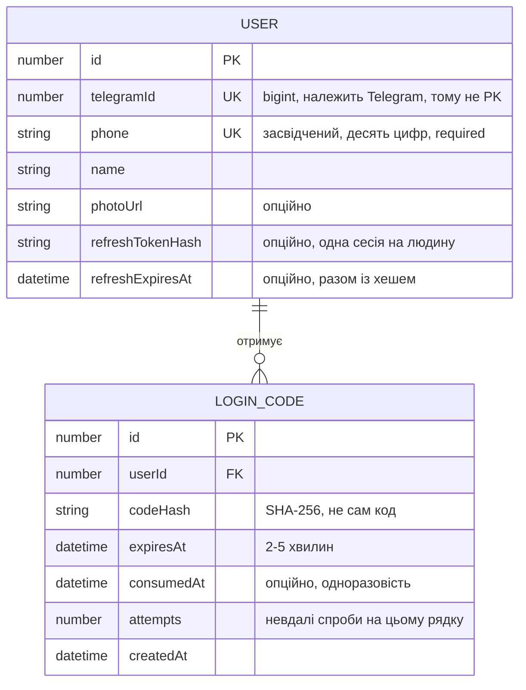

# ADR-0007 · Вхід за номером із кодом у чаті бота, сесії власні

**Статус:** Accepted · **Дата:** 2026-10-12 ·
**Замінює:** [ADR-0005](0005-authentication.md) в частині механізму входу

## Контекст

[ADR-0005](0005-authentication.md) обрав Firebase з входом за поштою й паролем
і закінчився відкритим питанням: пошта є не в усіх клієнтів автосервісу, а
механік знає саме номер. Вхід за номером тоді відкинули, бо підтвердження
номера вимагало платних SMS.

Telegram дає підтверджений номер безкоштовно через `request_contact`. Шляхів
звʼязати цей чат із застосунком два, і ми обрали другий.

**OIDC-редірект.** Authorization Code + PKCE, `id_token` з `phone_number`.
Один тап, без виходу в чат, але redirect URI для застосунку доки не
описують: приклади лише `https`, а Telegram обробляє винятково URL,
зареєстровані в BotFather. Невідомість блокувала б увесь вхід.

**Чат бота.** `request_contact` для номера, далі код у чат як доказ, що людина
це повідомлення бачила. Редіректів немає, отже й питань про них немає.

## Хиба в ADR-0005, яка закрила правильний шлях

ADR-0005 записав як факт: «бот не може написати першим, тож потік
перевертається: людина відкриває бота, а не отримує код на вимогу». Це
**напіввірно**, і саме це твердження приховало найкращий варіант від обох ADR.

Бот не може написати **незнайомому**. Знайомому — може коли завгодно: після
`/start` він знає `chat_id`, і `sendMessage` у цей чат працює без жодної дії з
боку людини. Тобто «отримати код на вимогу» можливе — вимогу лише треба
надіслати не в Telegram, а на наш API.

Звідси потік, який і ухвалюється.

## Визначальний факт: Telegram не поновлює токенів

Discovery-документ `https://oauth.telegram.org/.well-known/openid-configuration`
оголошує `grant_types_supported` лише `authorization_code`, і ніде немає ні
`refresh_token` у грантах, ні `offline_access` у скоупах.

Отже **Telegram — механізм автентифікації, а не постачальник сесії.** Роль
постачальника сесії, яку в ADR-0005 виконував Firebase, лягає на
`GarageOSWeb`. Для входу через чат це тим більше так: бот засвідчує номер один
раз і більше в житті сесії не бере участі.

## Рішення

**Telegram обовʼязковий.** Другого шляху входу немає й не передбачається: ні
пошти, ні паролю, ні соціальних провайдерів. Наслідки розписані нижче.

**Бот засвідчує номер. API видає коди й веде сесії.** Потік розпадається на
дві фази, і це головна властивість рішення.

### Фаза 1 — активація, разово на життя акаунта

1. На екрані входу є дрібне посилання «Вперше тут? Активувати бота». Воно
   відкриває `t.me/<bot>` — **без параметрів**
2. Бот на `/start` дивиться, чи знає цей `telegram_id`:
   - не знає → показує кнопку «Поділитися номером» (`request_contact`),
     перевіряє `contact.user_id == message.from.id`, зберігає `User`
   - знає → каже, що номер уже підтверджений
3. Бот пише «Готово. Введіть свій номер у застосунку» — завершення фази
   детерміноване, людина не гадає, чи вийшло

### Фаза 2 — вхід, щоразу й **без виходу в чат**

4. Людина вводить номер у застосунку
5. `POST /auth/request-code` — API зводить номер до десяти цифр і шукає `User`
6. API генерує код, інвалідує попередній, і бот надсилає новий у чат
7. Код приходить **пушем Telegram**; людина його копіює по тапу
8. `POST /auth/verify` з номером і кодом
9. API знаходить активний код користувача, порівнює хеші в постійному часі,
   витрачає рядок одним стейтментом і видає пару: короткий access-JWT і
   непрозорий refresh

Повторний вхід номера не підтверджує: він засвідчений один раз і лежить у
`User`.

**Виграш проти попередньої редакції цього ADR** (де код видавався в чаті
відразу після `/start`): похід у Telegram стався один раз у житті, а не на
кожен вхід. Відкрите питання «чи терпимий зворотний потік» цим закривається
майже цілком — лишається одна активація.

**`nonce` не потрібен.** Номер сам вказує, кому належить код, тож ні
попередньо відкритої сесії, ні опитування її стану немає. Побічна вигода:
зникає залежність від того, чи доставить Telegram `/start <payload>` у вже
розпочатий чат — поведінка, яку доки не описують. Доставляти в бот більше
нічого не треба.

**Введений номер — ключ пошуку, а не заява про особу.** Це межа, через яку цей
варіант не повторює відкинутий «екран введення номера»: засвідчує номер
`request_contact` у боті, а введений руками лише знаходить рядок у `users`.
Якщо він колись почне щось записувати або звʼязувати `Client`, вертається
діра з чужою карткою клієнта.

### Сутності

`User` позбувається пошти й паролю й отримує `telegramId`:

`telegramId` — unique-колонка, не PK, за тією самою логікою, що `firebaseUid`
в ADR-0005: ідентифікатор належить провайдеру й може змінитися. Тип —
`bigint`, бо Telegram віддає `user_id` як 64-бітне число, а не рядок.

**`phone` унікальний і обовʼязковий.** Унікальність — не акуратність, а умова
роботи кроку 5: на один номер мусить знаходитися один акаунт, інакше невідомо,
кому слати код. Обовʼязковість означає, що стану «акаунт без номера» не існує.

**Телефону в `login_code` немає свідомо.** Код видається користувачеві, який
на той момент уже існує в `User`. Отже `userId` достатній, а дубльований
телефон був би другим місцем, яке треба тримати в синхроні.

**Один активний код на людину.** Видача нового інвалідує попередній. Це не
прибирання, а властивість безпеки: кількість активних кодів — і є поверхня для
вгадування, тож її тримаємо мінімальною. Тримає це **частковий unique-індекс**
на `user_id` для невитрачених рядків, а не угода на словах.

**Доменної моделі й DTO `login_code` не має.** Три форми даних із
[ADR-0006](0006-backend-layering.md) тут зайві: код нікуди за межі сервера не
виходить і доменним поняттям не є. Це свідомий виняток, не недогляд.

### Код — повноцінний секрет

Хто його побачив, той зайде. Тому:

- **у БД лежить хеш**, не сам код. Без солі й KDF, і це теж свідомо: шість
  цифр перебираються офлайн миттєво, і жоден KDF цього не змінить. Хеш тут
  закриває **випадкове** читання — лог, бекап, погляд у psql; від
  цілеспрямованої атаки на дамп код захищає не хеш, а TTL
- **одноразовий**: `consumed_at` ставиться одним `UPDATE ... WHERE consumed_at
  IS NULL`, і рішення ухвалюється за кількістю змінених рядків. Читання плюс
  запис створило б гонку, у якій два запити отримали б одну сесію
- **TTL 2–5 хвилин**
- порівняння **в постійному часі**
- у повідомленні бота — «нікому не передавай»: чати перенаправляють і
  скріншотять

**Після успішного входу бот пише людині, що вхід відбувся.** Канал звʼязку вже
є, і це коштує один рядок, а дає жертві сигнал, якщо код колись вгадають.

### Ціна номера на вході: атака стає адресною

Це головна зміна в моделі загроз проти попередньої редакції, і її треба
назвати прямо.

Коли код видавався в чаті без номера, влучання у випадковий код давало
**випадковий** акаунт — саме тому арифметика `N/10⁶` і приймалася. Тепер
атакуючий вводить номер жертви й гадає **її** код. Якісно гірше.

Закривається тим, що та сама зміна й дає:

- **лічильник спроб на рядку коду.** Номер відомий **до** перевірки, тож рядок
  знаходиться навіть на неправильних цифрах — і є що інкрементувати. Після
  `MaxAttempts` код мертвий. Попередня редакція цього лічильника не мала й
  розглядала `nonce` саме щоб його повернути;
- **ліміт частоти за номером** — пауза між видачами коду на один номер. Ліміт
  за IP цього не закриває: без паузи чужий Telegram засипається кодами з
  різних адрес;
- **ліміт частоти за IP** на обидва ендпойнти — штатний rate limiting
  ASP.NET Core;
- мінімальна кількість активних кодів — звідси правило «один на користувача».

Дешевий запас — **вісім цифр замість шести**: `1/10⁸` замість `1/10⁶`. Коштує
майже нічого, бо Telegram копіює текст у моноширинному форматуванні по тапу,
тож людина код не передруковує. Рішення лишаємо за реалізацією (`LoginCode:Digits`).

### Невідомий номер: кажемо правду

Крок 5 на номер, якого немає в `users`, віддає `404` з текстом «Код не прийде
на цей номер — бот не активований або заблокований», а не ту саму відповідь,
що при успіху.

**Ухвалено так, хоч це й оракул** «чи користується цей номер GarageOS».
Причини: секрет слабкий — факт, що номер є в автосервісі, мало що відкриває; а
посилання «Вперше тут? Активувати бота» на екрані входу й так робить цю
інформацію публічною. Ціна однакової відповіді була б гіршою: людина, що
проґавила активацію, чекала б коду, якого не буде, і це той самий тупик, через
який потік і переробляли.

**Той самий текст іде й на недосяжний чат.** Бот заблокований, чат видалений,
`sendMessage` вернув `403` — для людини це одна ситуація з одним лікуванням:
піти в Telegram. Розрізняти їх на екрані нічого не дає. Відрізняти **збій
транспорту** від цих двох випадків усе одно обовʼязково, інакше кожна мережева
помилка читалася б як «активуй бота»; для цього є окремий тип виключення.

### Нормалізація номера — умова правильності, не гігієна

`Contact.phone_number` від Telegram приходить без `+` і в довільному вигляді.
Людина в застосунку введе `+38 067 …`, або `067…`, або з дефісами. Без
спільної нормалізації збігу не буде, і крок 5 скаже «бот не активований» при
активованому боті — повідомлення, яке прямо бреше й відправляє людину по колу.

Формат — **десять цифр**, той самий, що в усіх номерах контракту
(`ContractFormat.Phone`, дослівно `input.phone.replace(/\D/g, '').slice(-10)` з
клієнта). Нормалізація — на вході обох шляхів: і коли бот зберігає контакт, і
коли API приймає номер.

### Сесії

Access — JWT, близько 15 хвилин. `sub` = `User.id`, наш числовий, бо правила
авторизації читають `userId` саме з токена. Клейм `master` — коли `telegramId`
дорівнює `Telegram:OwnerId` з конфігу; обчислюється в момент видачі, тож зміна
конфігу не відкликає вже виданий токен до протермінування. Підпис HS256,
ключ у user secrets поряд із рядком підключення.

Refresh — непрозорі випадкові байти, не JWT: нам потрібне саме те, щоб токен
нічого не вартував без запису в БД. У сховищі — хеш.

**Refresh лежить двома колонками в `User`, не окремою таблицею:**
`refreshTokenHash` і `refreshExpiresAt`, обидві nullable і заповнюються разом.
Ротація — перезапис цих колонок при кожному поновленні. **Вихід — обнулення
обох**, і це вся потрібна механіка відкликання: окремого `revokedAt` не треба,
бо порожній хеш і є відкликаним станом.

Звідси три наслідки, які приймаються свідомо:

- **Одна сесія на людину.** Вхід на новому пристрої завершує попередній, без
  попередження. Для застосунку, де в майстра один телефон, це терпимо.
- **Виявлення повторного використання зникає.** Воно трималося на історії —
  ланцюжку `replaced_by`; з однією колонкою старий хеш перезаписується, тож
  скопійований токен не відрізнити від звичайного протермінування: обидва
  просто «не збіглися». Що лишається: ротація **все одно** обриває копію, бо
  щойно законний клієнт поновиться один раз, скопійований токен мертвий.
  Втрачається не захист, а сигнал.
- **Рядок `User` пишеться на кожне поновлення.** Це той самий рядок, на який
  посилаються `MyVehicle` і `Client`; при нашому навантаженні приймається.

Компенсація за втрачений сигнал уже є в потоці: бот пише людині про кожен
успішний вхід. Оскільки новий вхід до того ж вибиває стару сесію, людина
дізнається про чужий вхід двома шляхами — повідомленням у чаті й тим, що її
розлогінило.

**Refresh-токен — у `expo-secure-store`,** access — тільки в памʼяті.
ADR-0005 свідомо приймав, що Firebase SDK тримає refresh у нешифрованому
AsyncStorage; тут сховище наше, тож цей компроміс не потрібен.

**Підтверджений номер звʼязує картку клієнта автоматично.** `Client.userId?`
з ADR-0005 звʼязує картку СТО з акаунтом, але нічим це не автоматизує. Тепер
сервер зіставляє засвідчений номер із `Client.phone`, який завів механік —
у момент активації, а не входу. Правило «`Client.userId` записує лише майстер»
не порушується: звʼязок пропонує сервер на підставі засвідченого номера, а не
клієнт запитом.

## Розкладка в коді

Бот — **окремий проєкт і чистий транспорт**: `GarageOS.Telegram.Bot` розбирає
апдейти, тримає тексти чату й надсилає повідомлення. Рішень у ньому немає.

- що робити з `/start` і контактом, вирішує `ITelegramSignInService` у
  `GarageOS.Services`;
- коди видає й перевіряє `AuthService` там само. **Генерація коду переїхала з
  бота в API**, бо тепер її запускає HTTP-запит, а не повідомлення в чаті;
- `ITelegramNotifier` оголошений у `Services`, реалізований у проєкті бота —
  інакше шар сервісів залежав би від транспорту й не запускався б без Telegram.

Залежності: `Telegram.Bot → Services`, `Api → усі`. Розкладка п'яти проєктів —
[ADR-0006](0006-backend-layering.md).

## Як бот отримує апдейти

Два механізми, взаємно виключні: доки встановлено вебхук, `getUpdates` не
працює.

- **`getUpdates`, long polling** — не потребує публічного URL, тож працює з
  локальної машини. Зараз це єдиний придатний варіант, бо `GarageOSWeb` ще
  нікуди не задеплоєний. Апдейти, накопичені поки сервер лежав, **викидаються**
  (`DropPendingUpdates`): вони стосуються кодів, яких уже немає, і відповідати
  на них — писати людині через годину після її дії.
- **`setWebhook` із `secret_token`** — для продакшну. Telegram повертає цей
  токен у заголовку `X-Telegram-Bot-Api-Secret-Token` на кожному запиті, і
  обробник зобовʼязаний його звіряти; інакше вебхук приймає будь-що від
  будь-кого.

Рішення: long polling зараз, вебхук при деплої. Підміна — заміна одного
hosted-сервісу, решта коду її не бачить.

## Що це скасовує з ADR-0005

- **Firebase зникає цілком** — ні SDK на клієнті, ні `securetoken.google.com`
  на сервері, ні `Firebase:OwnerUid`
- **паролів немає як поняття** — отже немає ні скидання паролю, ні листів, ні
  денних квот на них, ні сторінки зміни паролю
- **`User.email` зникає**, а не стає nullable: Telegram пошти не віддає, і
  більше нікому її віддати
- **«Токени в БД не зберігаються взагалі» більше не діє.** Це головна ціна
  рішення: зʼявляється `login_code` із протермінуванням, а в `User` —
  хеш refresh-токена
- **«Бот не може написати першим» — неправда**, і наслідки розписані вище

Admin SDK, сервіс-акаунт, Client Secret, PKCE, обмін кода та перевірка
`iss`/`aud` — нічого з цього у варіанті з чатом немає.

## Що з ADR-0005 лишається чинним

Розділ **«Авторизація запитів»** — цілком, і читається як частина цього
рішення:

1. `userId` береться тільки з токена, ніколи з тіла чи query
2. перевірка власності — в тому ж запиті, що й вибірка
3. чужий ресурс — `404`, не `403`
4. `Client.userId` записує лише майстер
5. поля `role` у схемі немає; привілейований акаунт один, за параметром конфігу

Змінюється одна назва: `Firebase:OwnerUid` → `Telegram:OwnerId`.

## Альтернативи

**Код у чаті відразу після `/start`, без номера.** Попередня редакція цього
ADR. Відкинуто: вимагала походу в Telegram **на кожен вхід**, і саме це
ADR-0005 називав причиною відкинути Telegram. Дрібніше, але теж важливо: без
номера невдала здогадка не знаходить жодного рядка, тож лічильника спроб не
існувало й обмеження трималося на IP та глобальному сторожі.

**Код, привʼязаний до попередньо відкритої сесії (`nonce`).** Дав би той самий
лічильник спроб, що тепер дає номер. Відкинуто: тягне другу сутність,
ендпойнт відкриття сесії та залежність від доставки `/start <payload>` у вже
розпочатий чат, яка не гарантована.

**Опитування стану входу замість коду.** Вимагало неавтентифікованого
ендпойнта, 32 байтів ентропії, нерозрізненних відповідей на «не існує» й «уже
витрачено» — і давало недетерміноване завершення, коли людина не розуміє, чи
застосунок помітив вхід.

**Код на номер телефону через Telegram.** Відкинуто: бот пише в `chat_id`, а
не на номер. Надіслати код **на номер** можна лише окремим платним продуктом,
Telegram Gateway ($0.01 за доставлений код, ціну Telegram визначає на власний
розсуд) — тобто через те, що ADR-0005 відкинув за умовою «нуль витрат».
Ухвалений потік цього не робить: номер у ньому лише **знаходить** чат, який бот
уже знає.

**Дві рівні кнопки на екрані входу — «ввести номер» і «активувати бота».**
Відкинуто на користь ієрархії: поле номера основне, активація — дрібним
посиланням під кнопкою. Після першого тижня майже кожен запуск — повторний
вхід, де активація не потрібна; рівна кнопка змушувала б тисячу разів робити
вибір, який має значення один раз. Обидва шляхи при цьому на місці, і новачок
бачить свій **до** введення номера, тож у тупик «ввів номер, код не приходить»
не потрапляє.

**Однакова відповідь на невідомий номер.** Розписано вище, в розділі про
правду; відкинуто, бо тупик для новачка гірший за слабкий оракул.

**Telegram через OIDC-редірект.** Один тап замість активації. Відкинуто:
redirect URI для застосунку — незакрите доками питання, а для Expo потребувало
б dev client із associated domains або власного https-редіректу. Якщо колись
зʼясується, що кастомна схема приймається, це буде новий ADR, і міняти
доведеться лише фазу 1.

**`RefreshToken` окремою таблицею.** Дало б кілька сесій на людину,
`revokedAt` для адресного відкликання й ланцюжок `replacedById`, тобто
**сигнал** про скопійований токен. Відкинуто на користь двох колонок у `User`:
одна сесія на людину — достатньо, а ротація обриває копію й без ланцюжка.
Якщо колись знадобиться «активні сесії» з переліком пристроїв, це буде новий
ADR і міграція, бо колонки доведеться вивести в таблицю.

**Зберігати в БД і access-токен.** Відкинуто: JWT перевіряється підписом, і
жоден код не читає його зі сховища, тож запис не дає нічого, а копія живої
перепустки в дампі працює як справжня. Якщо колись знадобиться відкликати
access до протермінування, інструмент інший — короткоживучий denylist за
`jti`, не сам токен.

**Один непрозорий токен сесії замість JWT.** Дало б негайне відкликання й
миттєву дію зміни `Telegram:OwnerId`, без ключа підпису. Відкинуто: читання
БД на кожен запит проти нуля читань, і stateless-перевірка краще масштабується,
коли з'явиться веб-клієнт.

**Telegram Mini App із `initData`.** Відкинуто: продукт — самостійний
застосунок у сторах, не оболонка в Telegram.

**Firebase Email/Password (ADR-0005).** Відкинуто: пошта є бар'єром для
клієнта СТО, і це було відкритим питанням самого ADR-0005.

**Telegram плюс пошта як другий шлях.** Відкинуто остаточно: дві системи входу
означають два набори станів, два потоки відновлення й подвійну поверхню для
помилок — при тому, що обидва випадки відсутності Telegram закриваються без
них (див. наслідки).

**Firebase PNV.** Верифікує номер без SMS, але лише Android, українських
операторів у списку немає, і Firebase Auth не приймає PNV-токен як sign-in.

## Наслідки

**Добре:** нуль витрат і нуль зовнішніх залежностей, крім Telegram; вхід за
засвідченим номером — тим ключем, який механік і так знає; **повторний вхід не
виводить із застосунку**, похід у чат стався один раз у житті; номер
обовʼязковий, тож стану «акаунт без номера» не існує; паролів немає, отже
немає й усього їхнього хвоста; `Client.userId` звʼязується автоматично; ознака
майстра приходить клієнту клеймом; refresh у шифрованому сховищі; завершення
входу детерміноване; лічильник спроб живе на рядку коду, тобто перебір
вимірний і обмежуваний.

**Ціна:** своя таблиця `login_code` і дві колонки refresh у `User`; ключ
підпису й токен бота в секретах; **неавтентифікований ендпойнт видачі коду**,
якого попередня редакція окремо не мала; ліміт частоти за номером **і** за IP;
атака стала адресною (розписано вище). Плюс одна сесія на людину й відсутність
сигналу про скопійований токен — ціна розміщення refresh у `User`.

**Активація лишається зворотним потоком.** Людина виходить у чат бота,
ділиться номером і вертається. Це більше кроків, ніж один тап — але **разово**,
а не на кожен вхід. Саме стале повторення ADR-0005 називав причиною відкинути
Telegram; тут його немає.

**Бот стає частиною продакшн-інфраструктури.** Без живого бота ні активуватися,
ні отримати код неможливо — це не допоміжний канал, а єдині двері.

**Єдині двері — ухвалено.** Немає Telegram — немає власного входу. Кожен із
двох випадків закривається без другого методу автентифікації:

**Клієнт без Telegram не лишається поза системою.** ADR-0005 уже передбачає,
що `Client` існує **без** акаунта — картку створює й веде механік. Такій
людині просто немає чого прив'язувати: вона є в системі як клієнт СТО, лише
без особистого входу. Обовʼязковість Telegram обмежує доступ до *особистого
гаража*, а не участь у роботі сервісу.

**Майстер, що втратив доступ до Telegram, відновлюється через конфіг.**
`Telegram:OwnerId` — параметр конфігурації сервера, не рядок у БД. Хто має
доступ до конфігу, той перепризначає майстра на інший Telegram-акаунт одним
правленням. Аварійні двері вже існують, і це доступ до сервера, який у
власника є за визначенням. Саме тому локальний пароль для майстра не вводиться.

## Відкриті питання

Жодне з них не блокує реалізацію.

1. **Шість цифр чи вісім.** Арифметика вище; вісім коштують майже нічого, бо
   код копіюється з чату по тапу. Зараз `6`, параметром `LoginCode:Digits`.
2. **Глобальний сторож на частку невдалих перевірок.** Лічильник на рядку й
   ліміти за номером та IP є; сторожа, що ловить перебір як явище, ще немає.
3. **Прибирання протермінованих кодів.** Метод у репозиторії є, фонового
   виконавця — ні.
4. **Правила сторів.** Чи влаштує Apple єдиний вхід, що веде в сторонній
   застосунок і збирає номер (guideline 4.8). Перевірити до релізу.
